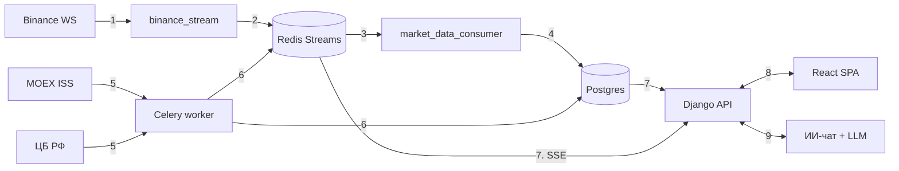

# TickFeedDmr

Сервис приёма рыночных данных (крипта Binance, акции MOEX, курсы ЦБ РФ) с REST/SSE API, React-фронтендом и ИИ-аналитиком рынка. Django 6.0, Python 3.14, зависимости через `uv`.

## Общая схема



**Что за чем:**

1. Binance присылает сделки по WebSocket, их принимает `binance_stream`.
2. `binance_stream` кладёт сделки в Redis Stream.
3. `market_data_consumer` читает стрим.
4. Консьюмер пишет сделки в Postgres.
5. Параллельно Celery worker по расписанию опрашивает MOEX и ЦБ.
6. Результат опроса пишется в Postgres, а свежие сделки акций ещё и в Redis Stream.
7. Django API отдаёт данные из Postgres, а живые сделки — из Redis Stream по SSE.
8. Фронтенд (React) ходит в API за данными и потоками.
9. ИИ-чат обращается через API к LLM и к данным.

Push-источники (Binance WebSocket) работают как долгоживущие management-команды, источники, которые нужно опрашивать по расписанию (MOEX, ЦБ), — как Celery-задачи.

## Документация

| Файл | О чём |
|---|---|
| [docs/01-architecture.md](docs/01-architecture.md) | сервисы, роли Redis, слои кода, маршруты |
| [docs/02-crypto-binance.md](docs/02-crypto-binance.md) | путь крипто-сделок: WebSocket → Redis Stream → Postgres |
| [docs/03-moex-cbr.md](docs/03-moex-cbr.md) | опрос MOEX и ЦБ через Celery |
| [docs/04-network.md](docs/04-network.md) | ретраи, таймауты, прокси, сертификаты |
| [docs/05-sse-live.md](docs/05-sse-live.md) | live-потоки SSE и выборка «latest N» |
| [docs/06-ai-chat.md](docs/06-ai-chat.md) | как ИИ-чат общается с пользователем и инструментами |
| [docs/07-ai-quota.md](docs/07-ai-quota.md) | токены и квота ИИ |

Документы описывают код на момент написания; при расхождении источник правды — код и `config/settings/base.py`.

## Быстрый старт

Основной сценарий — Docker. Достаточно Docker Compose, `just` не нужен: он лишь сокращает команды.

```
docker compose -f docker-compose.local.yml up --build -d     # собрать образы и поднять все сервисы
docker compose -f docker-compose.local.yml logs -f           # логи
docker compose -f docker-compose.local.yml down              # остановить
```

Остальные команды запускаются внутри контейнеров:

```
docker compose -f docker-compose.local.yml run --rm django python ./manage.py <args>   # manage.py
docker compose -f docker-compose.local.yml run --rm django pytest <args>               # тесты
docker compose -f docker-compose.local.yml run --rm -T django python ./manage.py dmr_export_schema config.api_router.schema --indent 2 --no-ensure-ascii > frontend/openapi.json.tmp && mv frontend/openapi.json.tmp frontend/openapi.json   # OpenAPI
```

Если установлен `just`, те же команды короче (он сам подставляет `-f docker-compose.local.yml`): `just up`, `just down`, `just logs`, `just build`, `just manage <args>`, `just pytest <args>`, `just schema`. Чтобы не писать `-f` каждый раз без `just`, можно выполнить `export COMPOSE_FILE=docker-compose.local.yml`.

- API: http://localhost:8000/api/, Swagger (только staff): `/api/docs/`
- Фронтенд: http://localhost:3000
- Суперпользователь: `docker compose -f docker-compose.local.yml run --rm django python ./manage.py createsuperuser`
- Расписание Celery хранится в БД: на чистой установке задач нет, периодические задачи добавляются вручную в Django admin.
- Секреты ИИ — в `.envs/.local/.ai` (шаблон `.ai.example`), включение — `AI_ENABLED=true`.

## Проверки

```
uv run ruff check .
uv run ruff format .
uv run mypy tickfeeddmr
docker compose -f docker-compose.local.yml run --rm django pytest   # локальный стек (или just pytest)
docker compose -f docker-compose.test.yml run --rm django pytest   # как в CI
```

Подробности по окружению и конвенциям проекта — в [CLAUDE.md](CLAUDE.md).

License: MIT
