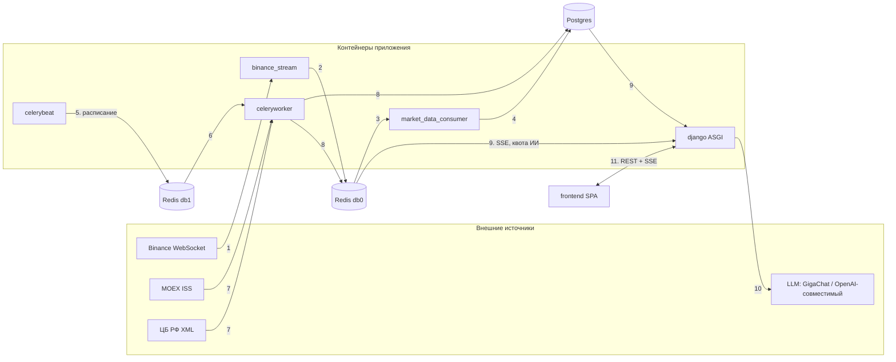
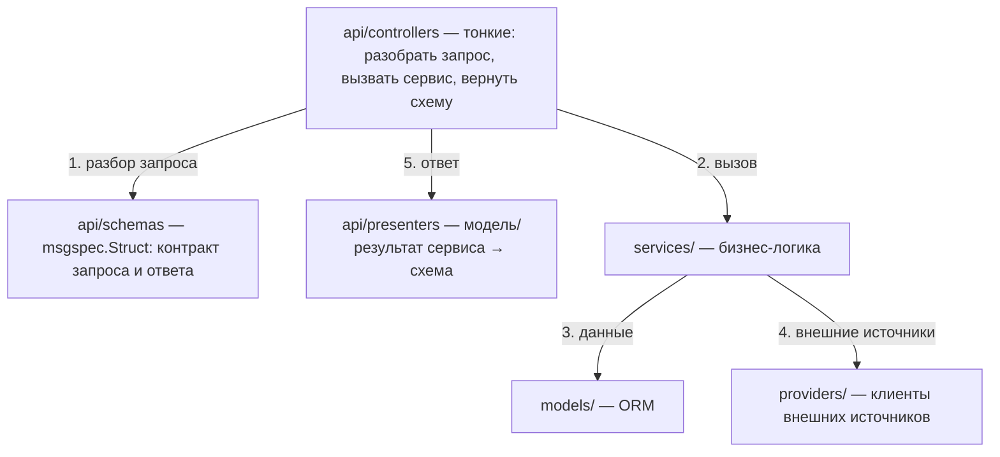

# 01. Архитектура

Обзор компонентов, ролей Redis и слоёв кода. Источник правды — код и `config/settings/base.py`; имена настроек указаны рядом с числами, чтобы их можно было найти grep-ом.

## Сервисы (`docker-compose.local.yml`)

| Сервис | Команда | Роль |
|---|---|---|
| `django` | `/start` (uvicorn, ASGI, :8000) | HTTP API, Django admin, Wagtail CMS; применяет миграции |
| `frontend` | `/start` (Vite, :3000) | React SPA, ходит в API на :8000 по CORS |
| `postgres` | — | основное хранилище (снапшоты, сделки, свечи) |
| `redis` | `redis-server --maxmemory ${REDIS_MAXMEMORY:-512mb} --maxmemory-policy noeviction` | стримы, локи, брокер Celery, квота ИИ |
| `binance_stream` | `manage.py stream_binance` | продюсер: WebSocket Binance → Redis Stream |
| `market_data_consumer` | `manage.py consume_market_data_stream` | консьюмер: Redis Stream → Postgres |
| `celeryworker` | `/start-celeryworker` | исполняет периодические задачи (MOEX, ЦБ, дневные свечи) |
| `celerybeat` | `/start-celerybeat` | планировщик (`DatabaseScheduler`, расписание хранится в БД) |

Все процессы Python (`django`, `binance_stream`, `market_data_consumer`, `celeryworker`, `celerybeat`) собираются из одного Dockerfile и build-контекста через YAML-якорь `&django` (у каждого сервиса свой тег образа); отличаются командой и зависимостями.

**Что за чем:**

1. Binance присылает сделки в `binance_stream`.
2. `binance_stream` кладёт их в Redis db 0 (стрим).
3. `market_data_consumer` читает стрим.
4. Консьюмер пишет сделки в Postgres.
5. `celerybeat` по расписанию ставит задачи в очередь (Redis db 1).
6. `celeryworker` забирает задачи из очереди.
7. Задачи опрашивают MOEX ISS и ЦБ РФ.
8. Результат пишется в Postgres, свежие сделки акций ещё и в Redis db 0.
9. Django берёт данные из Postgres, живые потоки и квоту ИИ из Redis.
10. Для ИИ-чата Django обращается к LLM.
11. Фронтенд общается с Django по REST и SSE.

## Три роли Redis

Один контейнер Redis обслуживает три независимых назначения. Они не делят конфиг и не должны мешать друг другу.

| Роль | БД | Настройка | Что лежит |
|---|---|---|---|
| Стримы, локи, квота ИИ | db 0 | `REDIS_URL` (`redis://redis:6379/0`) | `market_data:trades:binance`, `market_data:trades:moex`, стрим изменений `CryptoAsset`, локи опросов, счётчики `ai:usage:*` |
| Брокер Celery | db 1 | `CELERY_BROKER_URL` (`redis://redis:6379/1`) | очередь задач; `CELERY_RESULT_BACKEND = None` |
| Кэш Django | — | только production (`django-redis`); локально `LocMemCache` | — |

Брокер вынесен в отдельную БД намеренно: очередь задач не должна смешиваться со стримами сделок.

Политика памяти — `noeviction`: если стрим разрастается, падает его собственный `XADD`, а ключи Celery и локи не вытесняются. Volume в production сознательно не подключён.

### Ключи db 0

| Ключ | Тип | Кто пишет → кто читает |
|---|---|---|
| `market_data:trades:binance` (`MARKET_DATA_TRADE_STREAM_KEY`) | Stream | `stream_binance` → `market_data_consumer` (consumer group `market_data_ingest`), SSE-читатели |
| `market_data:trades:moex` (`MOEX_TRADE_STREAM_KEY`) | Stream | `poll_moex_trades` → SSE-читатели (без consumer group) |
| `market_data:crypto:asset_changes` (`MARKET_DATA_CRYPTO_ASSET_CHANGES_STREAM_KEY`) | Stream | сигналы `CryptoAsset` → `stream_binance` |
| `market_data:moex:lock:poll_board` / `…:poll_trades` | String (`SET NX EX`) | задачи опроса MOEX |
| `market_data:cbr:lock:poll_rates` | String | задача опроса ЦБ |
| `market_data:{crypto,stock,fiat}:lock:daily_candles` | String | догрузка дневных свечей |
| `ai:usage:*` (`AI_QUOTA_KEY_PREFIX`) | Hash (`requests`, `tokens`, флаги) | счётчики квоты ИИ — см. [07-ai-quota.md](07-ai-quota.md) |

## Слои кода

Бизнес-логика живёт в `tickfeeddmr/<app>/`, по одному каталогу на Django-приложение.

| Приложение | Назначение |
|---|---|
| `market_data` | ядро: приём данных, модели, провайдеры, REST/SSE API |
| `ai` | ИИ-аналитик рынка (чат + статус). Зависимость односторонняя: `ai → market_data` |
| `core` | интеграция с Wagtail (скрытие пунктов меню), задача-пинг |
| `users` | кастомный `User` (вход по e-mail), настроенный allauth; URL не подключены |
| `contrib/sites` | копия `django.contrib.sites` с локальными миграциями |

Внутри приложения слои строго разделены:

**Что за чем при обработке запроса:**

1. Контроллер разбирает запрос по схеме (`schemas`).
2. Вызывает сервис (`services`): вся логика только там.
3. Сервис читает или пишет данные через модели (`models`).
4. Если нужны внешние данные, сервис обращается к провайдеру (`providers`).
5. Контроллер превращает результат в схему ответа через презентер (`presenters`) и возвращает его.

- **`msgspec.Struct`** — единственное понятие «объект-значение» в проекте: контракты провайдеров, схемы API, внутренние spec-объекты. `dataclass` не используется.
- Каждый контроллер наследует `config/api_base.py::BaseController` (или `BaseSSEController` для SSE), а не `dmr.Controller` напрямую.
- Проверки значений настроек живут в `services/*/settings.py`, а не в `config/settings/base.py` (там только переменные).

## HTTP-маршруты

Всё API — под префиксом `api/`. Маршруты собирает `config/api_router.py`, монтирует `config/urls.py`.

| Префикс | Содержимое |
|---|---|
| `api/crypto/` | `assets/`, `assets/<symbol>/{current,trades,intraday,history}`, `stream` (SSE) |
| `api/stocks/` | список, `<secid>/{current,trades,intraday,history}`, `stream` (SSE) |
| `api/fiat/` | `rates/`, `rates/<iso_code>/history` |
| `api/ai/` | `status` (GET), `chat` (POST, SSE) |
| `api/docs/`, `api/docs/openapi.json` | Swagger UI и схема, только для staff |
| `api/admin/`, `api/cms/admin/`, `documents/` | Django admin, Wagtail admin, документы Wagtail |

`ATOMIC_REQUESTS` отключён: DMR-контроллер с `async def`-обработчиками считается асинхронным, а Django запрещает `ATOMIC_REQUESTS` с async-view.

## Что дальше

- Binance: [02-crypto-binance.md](02-crypto-binance.md)
- MOEX и ЦБ: [03-moex-cbr.md](03-moex-cbr.md)
- Сетевая устойчивость: [04-network.md](04-network.md)
- Live SSE: [05-sse-live.md](05-sse-live.md)
- ИИ-чат: [06-ai-chat.md](06-ai-chat.md)
- Токены и квота: [07-ai-quota.md](07-ai-quota.md)
