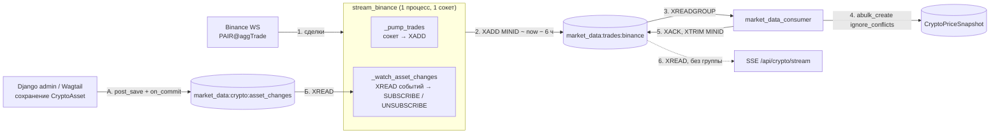
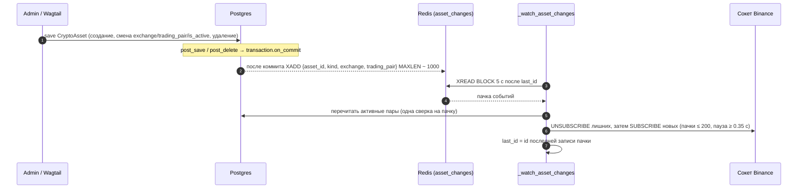
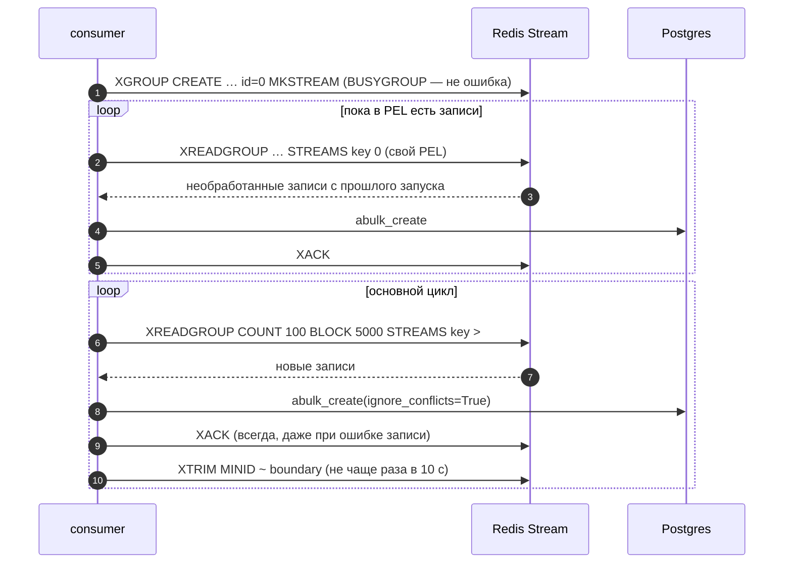

# 02. Крипта: Binance → Redis Stream → Postgres

Binance присылает сделки по WebSocket (push), поэтому приём устроен как два долгоживущих процесса, а не как Celery-задачи. Redis Stream между ними — буфер, который переживает падение любого из процессов.

## Общая схема



**Что за чем** (основной путь сделок, шаги 1–6):

1. Binance присылает сделки по одному WebSocket-соединению.
2. `stream_binance` кладёт каждую сделку в Redis Stream, заодно подрезая записи старше 6 часов.
3. `market_data_consumer` читает стрим через consumer group.
4. Консьюмер пачкой пишет сделки в Postgres (дубли игнорируются).
5. После записи консьюмер подтверждает прочитанное (`XACK`) и подрезает стрим.
6. Параллельно тот же стрим читают SSE-клиенты (без группы), см. [05-sse-live.md](05-sse-live.md).

Побочный путь (шаги А–Б): при сохранении `CryptoAsset` в админке уходит событие в отдельный стрим, и `stream_binance` меняет набор подписок на лету.

Процессы `stream_binance` и `market_data_consumer` не знают друг о друге и не делят моделей: единственная точка соприкосновения — формат записи в стриме (`services/trade_stream.py`).

## Продюсер: `stream_binance`

Одна команда, один event loop, два параллельных задания внутри `asyncio.TaskGroup`: если одно падает, падает и процесс (в compose `restart: unless-stopped`).

### Сокет и подписки

`BinanceTradeStreamConsumer` (`providers/binance/websocket.py`) держит **один** комбинированный сокет на все пары: `{BINANCE_WS_BASE_URL}/stream?streams=btcusdt@aggTrade/ethusdt@aggTrade/…`.

Разбор сообщения `aggTrade` в `TradeEvent`:

| Поле Binance | Поле `TradeEvent` | Преобразование |
|---|---|---|
| `s` | `trading_pair` | как есть (`BTCUSDT`) |
| `p` | `price` | `Decimal` |
| `q` | `volume` | `Decimal` |
| `m` (buyer is maker) | `side` | `m = true` → `sell`, иначе `buy` |
| `T` (мс) | `timestamp` | UTC `datetime` |
| `a` | `trade_id` | `str(a)` — aggregate trade id |

Сообщения неожиданного формата или с битым payload логируются и пропускаются, сокет не рвётся.

Переподключение: при `ConnectionClosed`/`OSError`/`JSONDecodeError` — пауза 1 с, затем удвоение до 30 с (`INITIAL_BACKOFF_SECONDS`, `MAX_BACKOFF_SECONDS`, `BACKOFF_MULTIPLIER`); после успешного соединения бэкофф сбрасывается. Каждое подключение берёт текущий желаемый набор пар, а не тот, с которым стартовало.

### Запись в стрим

Для каждого события:

```
XADD market_data:trades:binance MINID ~ <now_ms − 6 ч> * trading_pair … price … volume … side … timestamp … trade_id …
```

Запись — плоский dict строк (`serialize_trade_event`): `Decimal` и время сериализуются в строки (`str(price)`, `timestamp.isoformat()`), чтобы не терять точность.

Потолок `MINID ~ now − MARKET_DATA_TRADE_STREAM_CEILING_SECONDS` (по умолчанию 6 ч) подрезает стрим на каждом `XADD` и работает даже когда консьюмер лежит. `~` — приблизительная обрезка: удаляются только целые макро-узлы, лишнее может остаться, но больше запрошенного не удалится.

Ошибки Redis: ловятся только `REDIS_TRANSIENT_ERRORS` (обрыв соединения, таймаут) — продюсер закрывает сокет, ждёт бэкофф 1→30 с и начинает заново. Событие, на котором случился сбой `XADD`, **теряется**. Любая другая ошибка (например, `OOM` при заполненном Redis с `noeviction`) не перехватывается и роняет процесс.

### Живой набор пар

Набор подписок берётся из БД: `CryptoAsset` с `exchange = binance` и `is_active = true`. Он обновляется на лету, без перезапуска:



**Что за чем:**

1. Администратор сохраняет `CryptoAsset` (создание, смена `exchange` / `trading_pair` / `is_active`, удаление).
2. После коммита транзакции событие попадает в Redis Stream изменений.
3. Слушатель `stream_binance` ждёт новых событий (`XREAD BLOCK`).
4. Redis отдаёт пачку событий.
5. Слушатель один раз перечитывает активные пары из БД: пачка событий схлопывается в одну сверку.
6. Сокет получает `UNSUBSCRIBE` для лишних пар, затем `SUBSCRIBE` для новых.
7. Слушатель запоминает id последней обработанной записи.

Детали:

- **Какие изменения шлют событие.** Создание, удаление и изменение полей `exchange` / `trading_pair` / `is_active`. Изменение определяется без запроса в БД — по снимку полей, сделанному в `CryptoAsset.from_db`. Сохранение без изменения этих полей событие не шлёт. `kind` — `created` / `updated` / `deleted`.
- **Публикация после коммита.** Событие уходит через `transaction.on_commit`: если транзакция откатилась, события нет; если коммит прошёл — изменение уже видно в БД. Таймаут публикации — `MARKET_DATA_CRYPTO_ASSET_CHANGES_PUBLISH_TIMEOUT_SECONDS` (2 с). Недоступный Redis не ломает сохранение актива: ошибка логируется, подписки догонятся при следующем событии или после восстановления соединения слушателя.
- **Стартовый id.** `resolve_start_id` (`XREVRANGE … COUNT 1`) берётся **до** первого чтения пар из БД. Событие с id ≤ стартового опубликовано после коммита, то есть его эффект уже виден в БД; следующие события придут через `XREAD`. Блокирующее чтение с `$` не годится: между вызовами записи терялись бы.
- **Сверка по восстановлению.** После обрыва и восстановления соединения слушатель делает одну сверку с БД даже без событий: публикация, пришедшаяся на недоступный Redis, потеряна, и иначе её не заметить.
- **Применение к сокету.** `update_pairs` считает разницу между желаемым и подписанным наборами и шлёт управляющие сообщения `UNSUBSCRIBE`, затем `SUBSCRIBE` в открытый сокет — без переподключения. Лимиты: до 200 стримов в одном сообщении (`MAX_PARAMS_PER_REQUEST`), не чаще одного сообщения в 0.35 с (`CONTROL_MESSAGE_MIN_INTERVAL_SECONDS`), не более 1024 стримов на соединение (`MAX_STREAMS_PER_CONNECTION`): при превышении логируется ошибка и берутся первые 1024 по алфавиту.
- **Пустой набор.** Если активных пар не осталось, соединение закрывается, и процесс ждёт (`_pairs_available`), пока событие не вернёт хотя бы одну пару.
- **Не ловится.** Изменения через `QuerySet.update()` и `bulk_create` не отправляют сигналов; такие изменения подхватятся только при следующем событии или перезапуске.

## Консьюмер: `consume_market_data_stream`

Читает стрим через **consumer group** (`XREADGROUP`), пишет в `CryptoPriceSnapshot`. Имя группы — `MARKET_DATA_TRADE_CONSUMER_GROUP` (`market_data_ingest`), имя консьюмера — `MARKET_DATA_TRADE_CONSUMER_NAME` (`consumer-1`).



**Что за чем:**

1. При старте консьюмер создаёт группу (если она уже есть, это не ошибка).
2. Сначала он дочитывает **свои необработанные записи** с прошлого запуска (`XREADGROUP … 0`).
3. Redis отдаёт записи, которые были прочитаны, но не подтверждены.
4. Консьюмер пишет их в Postgres.
5. Подтверждает (`XACK`); шаги 2–5 повторяются, пока такие записи есть.
6. Затем начинается основной цикл: консьюмер просит **новые** записи (`>`), блокируясь до 5 с.
7. Redis отдаёт пачку (до 100 записей).
8. Консьюмер пишет пачку в Postgres.
9. Подтверждает пачку всегда, даже если запись в БД не удалась.
10. Не чаще раза в 10 секунд подрезает стрим. Шаги 6–10 повторяются бесконечно.

### Гарантии доставки

- **At-least-once.** Запись остаётся в PEL (Pending Entries List) до `XACK`. Если процесс упал между чтением и подтверждением, при старте консьюмер сначала дочитывает свой PEL (`XREADGROUP … 0`), и только потом переходит к новым записям (`>`).
- **Идемпотентность записи.** Повторная обработка одной пачки не создаёт дублей: `UniqueConstraint(asset, trade_id)` на `CryptoPriceSnapshot` и `abulk_create(ignore_conflicts=True)`. Строки, записанные до появления `trade_id`, имеют `NULL` и ограничением не защищены.
- **Отравленные сообщения не блокируют стрим.** Битая запись (`KeyError`/`ValueError`/`ArithmeticError` при разборе) логируется и пропускается. `XACK` выполняется **всегда**, в том числе когда запись в БД упала: цена — потеря данных этой пачки, выигрыш — один плохой элемент не может застопорить стрим навсегда.
- **Неизвестная пара.** Событие, для которого нет `CryptoAsset` с `(exchange, trading_pair)`, логируется как ошибка и пропускается; актив на лету не создаётся.
- **Запись, удалённая ретеншном до обработки.** Если запись из PEL уже обрезана, redis-py возвращает `(id, {})`. Это отдельный WARNING («обрезаны ретеншном»), а не «битая запись».

### Ретеншн

`XACK` запись из стрима не удаляет, поэтому без обрезки стрим растёт и при здоровой системе (измерено: ~111 байт на запись, ~430 тыс. записей ≈ 48 МБ для BTCUSDT). Обрезка двухуровневая:

| Кто | Когда | Граница |
|---|---|---|
| Продюсер | на каждом `XADD` | `MINID ~ now − MARKET_DATA_TRADE_STREAM_CEILING_SECONDS` (6 ч) — предохранитель на случай, когда консьюмер лежит |
| Консьюмер | после каждой успешно записанной пачки, не чаще `MARKET_DATA_TRADE_TRIM_INTERVAL_SECONDS` (10 с) | `XTRIM MINID ~ boundary` |

Граница консьюмера:

```
boundary_ms = min( ms(id последней записи, ушедшей в БД),
                   now_ms − MARKET_DATA_TRADE_TRIM_GAP_SECONDS × 1000 )   # gap = 300 с
```

Зазор в 5 минут оставляет позади границы хвост стрима для SSE-читателей, которые ещё внутри своего окна выборки (см. [05-sse-live.md](05-sse-live.md)). Если пачка не записалась, граница не двигается. После рестарта обрезка не выполняется, пока не пройдёт первая успешная пачка.

Проверки соотношений делает `validate_trade_stream_retention()` при импорте: все значения положительны, `ceiling > gap`, `interval < gap`; иначе `ImproperlyConfigured`.

Ограничение: такая граница корректна только для **одного** консьюмера в группе. С несколькими обрезка по «последней записанной» записи могла бы удалить то, что другой консьюмер ещё не прочитал.

### Таймауты Redis консьюмера

`socket_timeout = MARKET_DATA_TRADE_READ_BLOCK_MS / 1000 + 10 с` (то есть 15 с при блокировке 5 с): сокет живёт дольше самого блокирующего чтения. Обрыв и таймаут ловятся `REDIS_TRANSIENT_ERRORS`, дальше бэкофф 1→30 с и повторное создание клиента — с повторным дочитыванием PEL.

## Параметры

| Настройка | По умолчанию | Назначение |
|---|---|---|
| `BINANCE_REST_BASE_URL` | `https://api.binance.com` | REST-провайдер (история) |
| `BINANCE_WS_BASE_URL` | см. `base.py` | WebSocket |
| `MARKET_DATA_TRADE_STREAM_KEY` | `market_data:trades:binance` | ключ стрима сделок |
| `MARKET_DATA_TRADE_CONSUMER_GROUP` | `market_data_ingest` | группа консьюмеров |
| `MARKET_DATA_TRADE_CONSUMER_NAME` | `consumer-1` | имя консьюмера |
| `MARKET_DATA_TRADE_READ_COUNT` | 100 | записей за один `XREADGROUP` |
| `MARKET_DATA_TRADE_READ_BLOCK_MS` | 5000 | блокировка чтения |
| `MARKET_DATA_TRADE_STREAM_CEILING_SECONDS` | 21 600 (6 ч) | потолок продюсера |
| `MARKET_DATA_TRADE_TRIM_GAP_SECONDS` | 300 | зазор обрезки консьюмера |
| `MARKET_DATA_TRADE_TRIM_INTERVAL_SECONDS` | 10 | период обрезки |
| `MARKET_DATA_CRYPTO_ASSET_CHANGES_STREAM_KEY` | `market_data:crypto:asset_changes` | стрим изменений активов |
| `MARKET_DATA_CRYPTO_ASSET_CHANGES_MAXLEN` | 1000 | ограничение длины (`MAXLEN ~`): событие — лишь триггер перечитать БД |
| `MARKET_DATA_CRYPTO_ASSET_CHANGES_READ_BLOCK_MS` / `_READ_COUNT` | 5000 / 100 | параметры `XREAD` слушателя |
| `MARKET_DATA_CRYPTO_ASSET_CHANGES_PUBLISH_TIMEOUT_SECONDS` | 2.0 | таймаут публикации события |

## Модель данных

`CryptoAsset` (`exchange`, `trading_pair`, `symbol`, `display_name`, `is_active`) и `CryptoPriceSnapshot`: `asset`, `price` (20,8), `volume` (24,8), `side` (`buy`/`sell`), `trade_id`, `timestamp` (индексирован), `created_at`. Индекс `(asset, -timestamp)`, уникальность `(asset, trade_id)`.

Известные пробелы конвейера ведутся в `tickfeeddmr/market_data/stream_binance_flow.md`.
