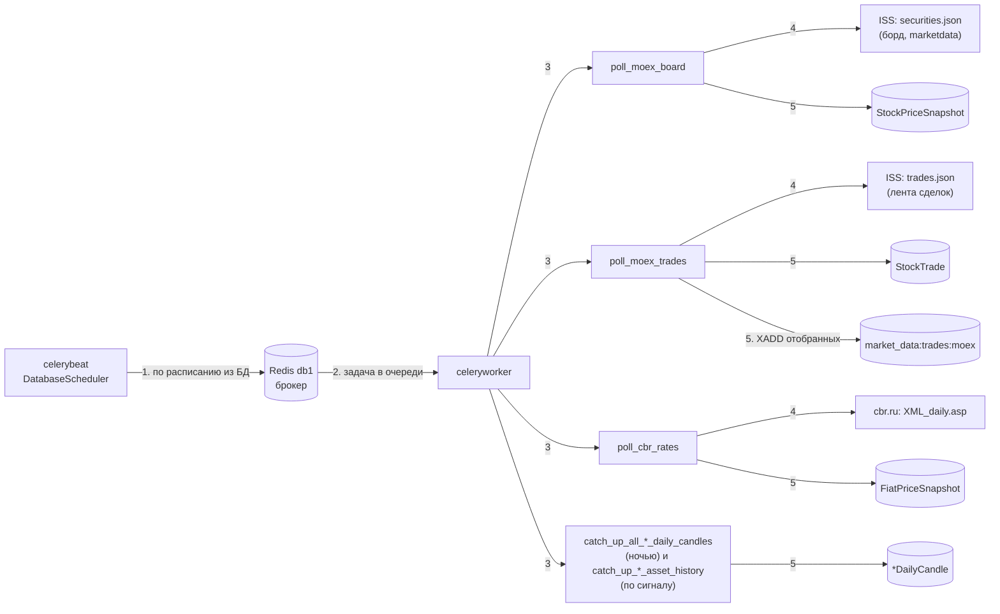
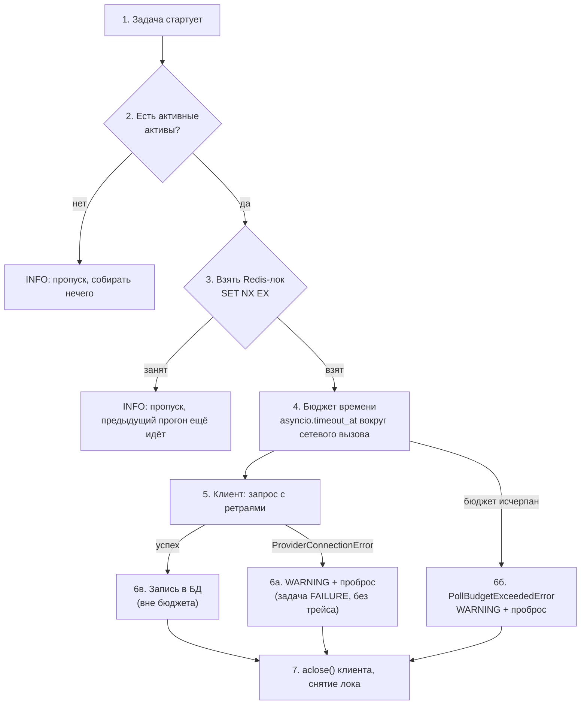
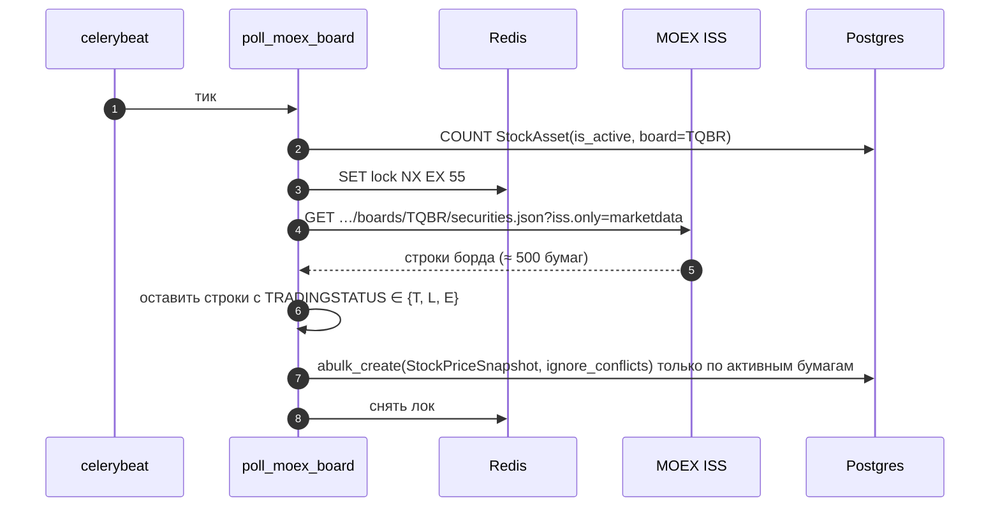
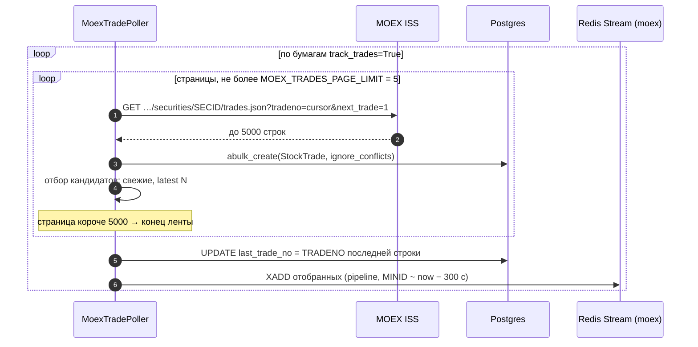
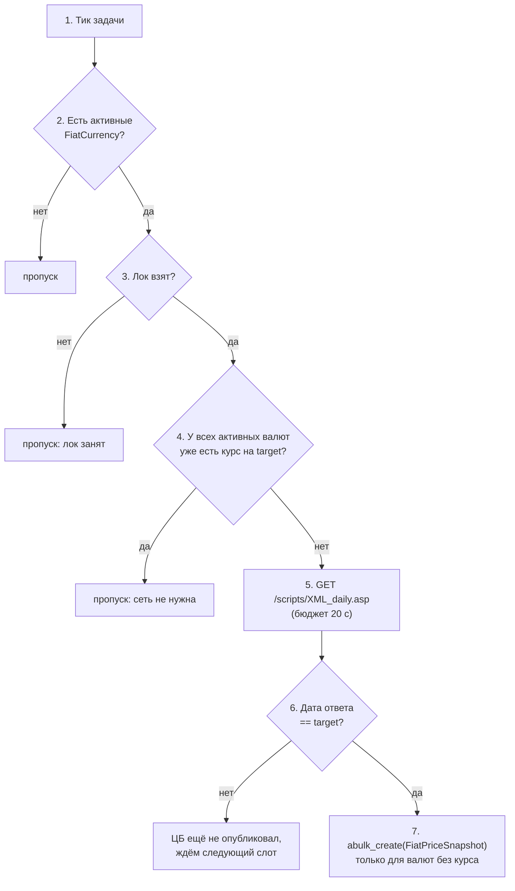

# 03. MOEX и ЦБ РФ: опрос по расписанию

У MOEX ISS и ЦБ нет push-каналов, поэтому их данные забирают **Celery-задачи** по расписанию, а не долгоживущие команды (как Binance, см. [02-crypto-binance.md](02-crypto-binance.md)). Сетевую устойчивость клиентов — ретраи, окна недоступности ISS — описывает [04-network.md](04-network.md); здесь — сама логика опроса.

## Общая схема



**Что за чем:**

1. `celerybeat` по расписанию, записанному в БД, ставит задачу в очередь.
2. Очередь живёт в Redis db 1; задачу забирает `celeryworker`.
3. Воркер запускает нужную задачу: опрос борда, опрос ленты сделок, опрос курсов ЦБ или догон дневных свечей.
4. Задача обращается к внешнему источнику: ISS MOEX или cbr.ru.
5. Полученное записывается в Postgres; отобранные сделки акций дополнительно уходят в Redis Stream для SSE.

Расписание хранится в БД (`django_celery_beat`), а не в коде: на чистой установке периодических задач нет, их добавляют руками в Django admin. Beat трактует расписание в `Europe/Moscow` (`CELERY_TIMEZONE`). Результаты задач не хранятся (`CELERY_RESULT_BACKEND = None`), наблюдаемость — через логи.

Рабочий процесс Celery синхронный, провайдеры асинхронные: каждая задача вызывает `asyncio.run(...)`.

## Единый каркас прогона

Все три опроса устроены одинаково:



**Что за чем:**

1. Задача стартует.
2. Проверяет, есть ли что собирать (активные активы). Если нет, тихо выходит.
3. Берёт Redis-лок. Если лок занят, предыдущий прогон ещё идёт, и этот пропускается.
4. Включает бюджет времени на сетевые вызовы.
5. Клиент делает запрос с повторами при сбоях.
6. Дальше три исхода: а) источник недоступен, записывается WARNING, ошибка пробрасывается; б) бюджет вышел, то же самое; в) успех — данные пишутся в БД (это вне бюджета).
7. В любом случае клиент закрывается и лок снимается.

Ключевые правила:

1. **Лок** — `redis_lock` (`services/locks.py`): `SET key token NX EX ttl`, снятие через Lua-скрипт «удалить, только если токен мой». Живёт на `REDIS_URL` (db 0), рядом с остальными ключами `market_data:*`. Если лок занят, прогон пропускается без ошибки.
2. **Бюджет** — абсолютный дедлайн, оборачивающий **только сетевые вызовы**. Запись в БД под бюджет не попадает: async ORM выполняет запрос в потоке, а отмена `await` поток не прерывает — запись дошла бы до конца уже после снятия лока.
3. **Вложенность фиксирована:** `redis_lock` → бюджет → клиент, а `provider.aclose()` — в `finally` снаружи бюджета. Тогда отмена по бюджету превращается в `PollBudgetExceededError` на выходе из своего scope, до закрытия клиента и снятия лока.
4. **Недоступность источника не маскируется под успех.** Поллер пишет одну строку WARNING и пробрасывает исключение; задачи объявляют `ProviderConnectionError` и `PollBudgetExceededError` в `throws=`, поэтому Celery помечает тик FAILURE, но логирует его как «raised expected» (INFO, без трейса). Всё остальное (4xx, парсинг, БД) падает с полным трейсом.
5. **Инвариант настроек** (`services/moex_polling/settings.py` и `services/cbr_polling/settings.py`, проверяется при импорте): `budget > 0` и `TTL − budget ≥ 5 с`. Запас покрывает то, что внутри лока, но вне бюджета: запись в БД, `aclose()`, снятие лока.

### Параметры прогонов

| Прогон | Бюджет | TTL лока | Ключ лока | Тик |
|---|---|---|---|---|
| Борд MOEX | `MOEX_BOARD_POLL_BUDGET_SECONDS` = 45 с | `MOEX_BOARD_POLL_LOCK_TTL_SECONDS` = 55 с | `market_data:moex:lock:poll_board` | 60 с |
| Сделки MOEX | `MOEX_TRADES_POLL_BUDGET_SECONDS` = 100 с | `MOEX_TRADES_POLL_LOCK_TTL_SECONDS` = 120 с | `market_data:moex:lock:poll_trades` | 60 с |
| Курсы ЦБ | `CBR_POLL_BUDGET_SECONDS` = 20 с | `CBR_POLL_LOCK_TTL_SECONDS` = 30 с | `market_data:cbr:lock:poll_rates` | слоты в течение дня |

Для борда TTL 55 с меньше тика: лок, осиротевший после жёсткого падения процесса, истекает до следующего тика. Для сделок бюджет 100 с и TTL 120 с сознательно больше тика: догон ленты законно длится дольше минуты, следующий тик при этом пропускается по занятому локу.

Значения тика задаются в расписании в admin, в коде их нет; в таблице указаны ориентиры, на которые рассчитаны бюджет и TTL.

## Снимок борда MOEX (`poll_moex_board`)



**Что за чем:**

1. `celerybeat` запускает задачу по тику.
2. Задача считает активные бумаги борда; если их нет, выходит.
3. Берёт Redis-лок на 55 секунд.
4. Запрашивает у ISS снимок всего борда.
5. ISS отдаёт около 500 строк.
6. Оставляются только строки, где идут торги (статус `T`, `L` или `E`).
7. В Postgres пишутся снимки по активным бумагам; дубли игнорируются.
8. Лок снимается.

- Борд по умолчанию — `MOEX_DEFAULT_BOARD` (`TQBR`), эндпоинт `/iss/engines/stock/markets/shares/boards/{board}/securities.json`.
- ISS отдаёт **весь борд** (порядка 500 бумаг), а в БД пишется только то, что есть среди активных `StockAsset` этого борда; остальное — `skipped_unknown_asset`.
- Статусы торгов: пишутся только `T` (торговая сессия), `L` (аукцион закрытия), `E` (торги по цене аукциона закрытия). Остальные значения (`N/O/C/F/B/D/I/S`, фазы аукционов) — «торги не идут», снапшот не пишется. Статус `L`/`E` нужен, чтобы не потерять официальную цену закрытия дня (18:40–18:50 МСК).
- Лаг данных ISS логируется: `lag = now − max(timestamp)`. Данные ISS отстают примерно на 15 минут (`MOEX_DATA_DELAY_SECONDS = 900`).
- Идемпотентность: `UniqueConstraint(asset, timestamp)` и `ignore_conflicts=True`. Точное число отброшенных дублей ORM при `ignore_conflicts` не возвращает, поэтому `written` — число подготовленных строк, а не реально вставленных.

`StockPriceSnapshot` — **одна строка на интервал опроса**, агрегат борда (OHLC, объём `volume`, оборот `value`, `num_trades`, `change`, `change_percent`). Это не лента сделок: у MOEX нет push-канала сделок по акциям.

## Лента сделок MOEX (`poll_moex_trades`)

Собирается только для бумаг с `track_trades=True`: полная лента ликвидного тикера за день — сотни тысяч строк.

Состояние прогона между тиками — **курсор** `StockAsset.last_trade_no` (номер последней записанной сделки `TRADENO`).



**Что за чем** (для каждой бумаги с `track_trades=True`):

1. Задача просит у ISS страницу сделок начиная с сохранённого курсора.
2. ISS отдаёт до 5000 строк.
3. Страница сразу пишется в Postgres.
4. Из строк отбираются «свежие» кандидаты для живой ленты (последние N).
   Шаги 1–4 повторяются, пока приходят полные страницы, но не больше 5 страниц за прогон.
5. Курсор `last_trade_no` обновляется номером последней записанной сделки.
6. Только после этого отобранные сделки уходят в Redis Stream для SSE.

- **Порядок «курсор → стрим» зафиксирован.** Сначала страницы пишутся в БД, затем сохраняется `last_trade_no`, и только после этого сделки уходят в Redis. Падение между шагами даёт пропуск в живой ленте тикера, но никогда дубль: у `XADD` нет идемпотентности. Сбой публикации в стрим только логируется (WARNING) и задачу не роняет: данные уже в БД, а живая лента — надстройка над ней.
- **Дочитывание.** Первое чтение без курсора начинает с начала дня. Если за прогон выбрано `MOEX_TRADES_PAGE_LIMIT` полных страниц, пишется WARNING, а догон продолжается на следующем тике с сохранённого курсора.
- **Бюджет — общий на весь прогон** (дедлайн считается один раз перед циклом по бумагам). Запись страницы в БД и сохранение курсора выполняются вне `poll_budget_scope`. При исчерпании бюджета WARNING сообщает, на какой бумаге прогон прерван и сколько обработано.
- **Идемпотентность записи.** `UniqueConstraint(asset, trade_id)` + `ignore_conflicts=True`.

### Отбор сделок для живой ленты (уровень 1)

В Redis уходит не вся лента, а только «свежая» часть, и не больше `N` на бумагу за прогон:

```
cutoff = now − (MOEX_DATA_DELAY_SECONDS + MOEX_TRADE_STREAM_FRESHNESS_SECONDS)
       = now − (900 + 300) с                       # 20 минут
кандидат   = сделка с timestamp ≥ cutoff
в стрим    = latest(кандидаты, n = MOEX_TRADE_STREAM_TOP_N = 10)   # ключ: (timestamp, TRADENO)
```

Свежесть считается с поправкой на лаг ISS: у ISS сделки приходят примерно на 15 минут позже события. Ключ сравнения `(timestamp, trade_id)`: `SYSTIME` у ISS с точностью до секунды, а сделок в секунду несколько, `TRADENO` растёт монотонно и разводит их детерминированно. Правило отбора — подменяемая функция (`services/stream_selection.py`); поллер менять не нужно.

У стрима `market_data:trades:moex` нет consumer group: докачки нет, поэтому единственный ретеншн — `MINID ~ now − MOEX_TRADE_STREAM_RETENTION_SECONDS` (300 с) на каждом `XADD`. Второй уровень отбора (на каждого SSE-клиента) описан в [05-sse-live.md](05-sse-live.md).

## Курсы ЦБ РФ (`poll_cbr_rates`)

ЦБ публикует курс на **следующий** рабочий день заранее, поэтому поллер всегда ждёт курс на завтра:

```
target = (сегодня по Москве) + 1 день
```



**Что за чем:**

1. Приходит тик задачи.
2. Если нет активных валют, выход.
3. Если лок занят, выход.
4. Проверка без сети: если курс на завтрашнюю дату уже есть у всех валют, выход.
5. Иначе запрос в ЦБ (`XML_daily.asp`) с бюджетом 20 секунд.
6. Если ЦБ отдал не завтрашнюю дату, он ещё не опубликовал курс, ждём следующий слот.
7. Если дата совпала, курсы записываются в Postgres только для валют, у которых их ещё нет.

- Первая проверка идёт **без сети**: если курс на `target` уже есть у всех активных валют, прогон завершается, не обращаясь к ЦБ. Поэтому расписание можно ставить с запасом слотов: лишние тики дешёвые.
- Один запрос `XML_daily.asp` возвращает все валюты. Отдельного класса-провайдера нет: `fetch_history` и `stream` здесь не нужны, достаточно `CbrDailyRatesClient.get_daily_rates()`.
- Валюта сопоставляется по `cbr_id`. Курс привязывается к началу дня `effective_date` по Москве (`timestamp = дата 00:00 МСК → UTC`).
- Идемпотентность: `UniqueConstraint(asset, effective_date)`, плюс заранее собирается множество валют, у которых курс уже есть.
- Единственный источник курсов — ЦБ РФ; поля `source` у `FiatCurrency` нет намеренно.
- Бюджет здесь — обычный `asyncio.timeout_at`, исчерпание превращается в `CbrPollBudgetExceededError` (отдельный класс для ЦБ). XML парсится через `defusedxml`.

## Дневные свечи (догон)

Отдельный от опросов механизм: исторические дневные свечи для всех трёх доменов (крипта, акции, курсы ЦБ) собираются одним общим раннером (`services/daily_candles/runner.py`):

- **По сигналу.** `post_save` по новому активу ставит задачу `catch_up_*_asset_history`: актив получает историю сразу, а не к следующей ночи. Задача ретраится при `ProviderConnectionError` (`autoretry_for`, `retry_backoff`, не более 5 раз).
- **Ночью.** `catch_up_all_*_daily_candles` обходит не более `MARKET_DATA_DAILY_CANDLES_MAX_ASSETS_PER_RUN` (50) активов за прогон; недогруженное продолжится следующей ночью. Это основной механизм защиты `poll_moex_board` и остальных периодических задач от вытеснения долгим прогоном.
- Граница догона — «вчера по Москве» (`moscow_yesterday`).
- У каждого домена свои лок, бюджет и TTL:

| Домен | Ключ лока | Бюджет | TTL |
|---|---|---|---|
| Крипта | `market_data:crypto:lock:daily_candles` | `CRYPTO_DAILY_CANDLES_POLL_BUDGET_SECONDS` = 120 | `…_LOCK_TTL_SECONDS` = 140 |
| Акции | `market_data:stock:lock:daily_candles` | `STOCK_DAILY_CANDLES_POLL_BUDGET_SECONDS` = 300 | `…_LOCK_TTL_SECONDS` = 330 |
| Курсы ЦБ | `market_data:fiat:lock:daily_candles` | `FIAT_DAILY_CANDLES_POLL_BUDGET_SECONDS` = 60 | `…_LOCK_TTL_SECONDS` = 75 |

- Раннер проверяет бюджет **между активами**: если он вышел, прогон завершается штатно (`budget_exhausted=True`). Ошибка провайдера или неожиданное исключение на одном активе логируется и не останавливает остальные.

Свечи читаются API и инструментами ИИ-чата (`get_period_stats`, `get_indicators`, `find_big_moves`, см. [06-ai-chat.md](06-ai-chat.md)).

## Модель данных

| Модель | Строка | Уникальность |
|---|---|---|
| `StockAsset` | бумага: `board`, `symbol` (SECID), `track_trades`, `last_trade_no` | `(board, symbol)` |
| `StockPriceSnapshot` | агрегат борда за интервал опроса | `(asset, timestamp)` |
| `StockTrade` | одна сделка ленты (`trade_id` = TRADENO, `price`, `quantity`, `side`, `period`) | `(asset, trade_id)` |
| `FiatCurrency` | валюта: `cbr_id`, `symbol` | — |
| `FiatPriceSnapshot` | курс на `effective_date` | `(asset, effective_date)` |

Снапшоты и сделки имеют разный ритм записи и схему — не смешивайте их: поэтому `StockTrade` в админке не входит в группу «Снапшоты».
