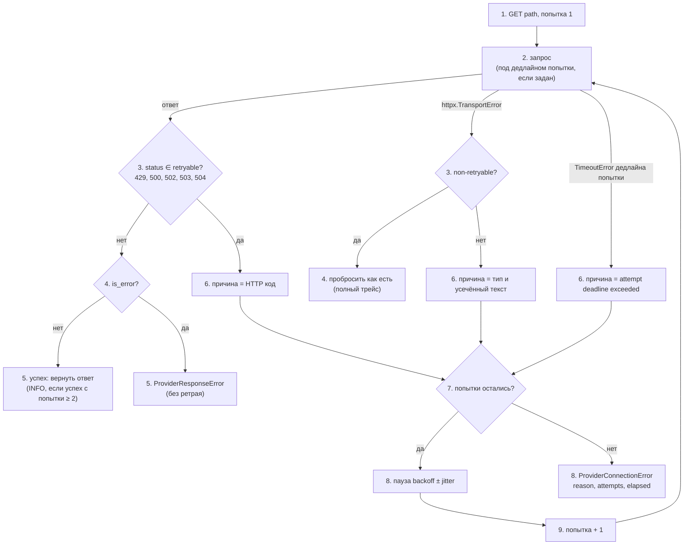

# 04. Сетевая устойчивость

Как проект ходит во внешние сервисы и что делает при сбоях. Сетевых «контуров» пять, и у каждого своя политика:

| Контур | Протокол | Где живёт | Политика сбоев |
|---|---|---|---|
| MOEX ISS | HTTPS GET | `providers/moex/client.py` | 7 попыток, бэкофф 1→8 с, дедлайн попытки 12 с |
| ЦБ РФ | HTTPS GET | `providers/cbr/client.py` | 3 попытки, бэкофф 1→4 с |
| Binance | WebSocket | `providers/binance/websocket.py` | бесконечный реконнект, бэкофф 1→30 с |
| Redis | TCP | `services/redis_retry.py` | бесконечный реконнект, бэкофф 1→30 с |
| LLM (GigaChat, OpenAI-совместимые) | HTTPS | `ai/services/llm/` | `max_retries=1` в SDK, без реконнекта на уровне чата |

## HTTP-клиенты MOEX и ЦБ: общий `RetryingHttpClient`

Оба клиента используют один механизм повторов — `providers/http_retry.py` (`RetryingHttpClient` + `RetryPolicy`). Различаются только константы политики, поэтому правка поведения ретраев делается в `http_retry.py`, а не копируется в оба клиента.

**Что за чем:**

1. Клиент начинает с первой попытки.
2. Делает запрос; если задан жёсткий дедлайн попытки, запрос идёт под ним.
3. Дальше три возможности:
   - пришёл ответ: смотрим статус (повторяемый ли: 429, 500, 502, 503, 504);
   - сетевая ошибка: смотрим, из числа ли тех, что не ретраятся (проверка сертификата, прокси, протокол);
   - вышел дедлайн попытки.
4. Неповторяемый статус: если это успех, ответ возвращается (шаг 5), если ошибка (например, 404), сразу `ProviderResponseError`. Неретраимая сетевая ошибка пробрасывается как есть, с полным трейсом.
6. Повторяемый статус, повторяемая сетевая ошибка или дедлайн попытки: запоминается причина.
7. Если попытки ещё остались, клиент ждёт (шаг 8), увеличивает номер попытки (шаг 9) и возвращается к шагу 2.
8. Если попытки кончились, поднимается `ProviderConnectionError` с причиной, числом попыток и временем.

### Параметры

| Параметр | MOEX ISS | ЦБ РФ |
|---|---|---|
| `MAX_ATTEMPTS` | 7 | 3 |
| Бэкофф | 1 → 8 с, множитель 2 | 1 → 4 с, множитель 2 |
| Jitter | ±20% (`BACKOFF_JITTER = 0.2`) | ±20% |
| Таймаут соединения | 5 с | 5 с |
| Таймаут запроса (на операцию httpx) | 10 с | 10 с |
| Жёсткий дедлайн попытки | **12 с** (`asyncio.timeout`) | нет |
| Повторяемые статусы | 429, 500, 502, 503, 504 | те же |
| Усечение текста причины | 200 символов | 200 символов |

Пауза после неудачной попытки `n`: `min(max_backoff, initial × multiplier^(n−1)) × uniform(1 − jitter, 1 + jitter)`. Для MOEX паузы равны примерно 1, 2, 4, 8, 8, 8 с (сумма ≈ 31 с).

**Зачем жёсткий дедлайн попытки.** Таймауты httpx действуют на отдельные операции (соединение, чтение), а не на запрос целиком: сервер, который отдаёт тело по байту, держал бы попытку неограниченно. `asyncio.timeout(12 с)` вокруг запроса ограничивает попытку целиком. Только собственный дедлайн попытки трактуется как повторяемая ошибка; внешняя отмена (например, бюджет прогона) приходит как `CancelledError` и не перехватывается.

**Худший случай для MOEX:** 7 × 12 с + ≈ 31 с ≈ 115 с на один запрос. Это больше бюджета прогона борда (45 с) и сопоставимо с бюджетом ленты сделок (100 с), поэтому на практике серию попыток обрывает бюджет прогона (см. [03-moex-cbr.md](03-moex-cbr.md)). Для ЦБ 3 попытки с паузами ≈ 1 + 2 с укладываются в бюджет 20 с.

### Что не ретраится

Эти ошибки — проблемы конфигурации или безопасности, а не временный сбой; они пробрасываются сразу, с полным трейсом:

- `ssl.SSLCertVerificationError` в цепочке причин (проверяется по всей цепочке `__cause__`/`__context__`);
- `httpx.ProxyError` (его текст может содержать URL прокси с учётными данными, поэтому в лог причина не попадает);
- `httpx.UnsupportedProtocol`;
- `httpx.LocalProtocolError`.

Статусы вне списка повторяемых (4xx, 501, 505…) не ретраятся: `ProviderResponseError` с первыми 500 символами тела в логе.

### Что попадает в лог

- Каждая неудачная попытка — только DEBUG (в `root` на INFO она не видна).
- Успех с попытки ≥ 2 — одна строка INFO: номер попытки, время, последняя причина.
- Исчерпание попыток — `ProviderConnectionError`, в сообщении которого уже есть причина, число попыток и время: Celery логирует ожидаемые ошибки как `repr` исключения, а `__cause__` при передаче между процессами prefork-пула теряется. В `args` исключения лежит только сообщение, чтобы оно восстанавливалось при unpickle; `reason`/`attempts`/`elapsed_seconds` — атрибуты.
- Текст причины сводится к одной строке и обрезается: он попадает в строки лога, и перевод строки внутри позволил бы подделать соседнюю запись.
- Если запрос оборван бюджетом прогона, исключение с причиной так и не поднялось. Для этого клиент хранит `last_failure_reason` (сбрасывается в начале каждого запроса); поллер добавляет её в `PollBudgetExceededError` и WARNING.

## Окна недоступности ISS

Периметр MOEX ISS периодически рвёт соединения окнами примерно по 60–80 с (измерено напрямую, не по документации), чередуя их с «хорошими» окнами такой же длины. В плохом окне теряются SYN, зависает TLS, обрывается тело ответа. Отказы наблюдались одновременно с двух независимых IP-адресов, а посторонние хосты не падали — то есть причина на стороне периметра MOEX, а не в частоте или схеме наших запросов.

Из этого следует:

- **Транзитные ошибки ISS — ожидаемое событие**: ретраи с бэкоффом плюс бюджет, одна строка WARNING вместо трейса.
- **Не переиспользовать HTTP-соединение между тиками.** Простаивающее keep-alive-соединение к ISS умирает примерно за 5 с, а установленные соединения умирают и в плохих окнах. Тик идёт раз в минуту, поэтому постоянный клиент на воркер ничего не даст.
- **Проверка из production-сети нужна отдельно**: на машине разработчика VPN в режиме TUN терминирует TCP локально, и недоступность апстрима выглядит как `ConnectError` в фазе TLS через ≈ 5 с. Не читайте «TCP прошёл, TLS упал» буквально.
- Файл `market_data/moex_poll_connection_errors.md` содержит прежнюю, опровергнутую гипотезу («churn соединений»); источник правды — этот раздел.

## Binance WebSocket

- Одно соединение на все пары; при обрыве (`ConnectionClosed`, `OSError`, `JSONDecodeError`) — реконнект с паузой 1 с, удвоением до 30 с, сброс паузы после успешного подключения.
- Каждое подключение берёт текущий желаемый набор пар, а не стартовый.
- Состояние подписок открытого сокета сбрасывается при обрыве; управляющие сообщения `SUBSCRIBE`/`UNSUBSCRIBE` ограничены по частоте и размеру (см. [02-crypto-binance.md](02-crypto-binance.md)).
- Подробности о потере события на сбое `XADD` — там же.

## Redis

`RedisRetryLoop` (`services/redis_retry.py`) используют продюсер, слушатель изменений активов и консьюмер:

- ловятся только `ConnectionError` и `TimeoutError` Redis (`REDIS_TRANSIENT_ERRORS`);
- бэкофф 1 → 30 с, множитель 2; `reset()` после восстановления;
- для блокирующих чтений `socket_timeout = block_ms / 1000 + 10 с` (`REDIS_SOCKET_TIMEOUT_MARGIN_SECONDS`): сокет не должен срабатывать раньше, чем заканчивается сама блокировка;
- после восстановления слушатель изменений делает одну сверку с БД, консьюмер заново дочитывает свой PEL.

Публикация событий изменения `CryptoAsset` из синхронного кода (admin) использует отдельный синхронный клиент с таймаутом 2 с и сбой не пробрасывает.

## LLM-провайдеры

Клиенты LLM строятся так, чтобы случайные настройки окружения не меняли путь трафика.

### Провайдеры на OpenAI SDK (`custom:`)

`build_http_client` (`ai/services/llm/http.py`) создаёт `httpx2.AsyncClient`:

| Параметр | Значение |
|---|---|
| `trust_env` | `False` — глобальные `HTTPS_PROXY`/`ALL_PROXY` из окружения **не** подхватываются |
| прокси | `AI_PROXY_URL`, и только если префикс провайдера входит в `AI_PROXY_PROVIDERS` (по умолчанию `["custom"]`) |
| `verify` | `True`, отключать запрещено |
| таймауты | connect 10 с, read `AI_READ_TIMEOUT_SECONDS` (60 с), write 10 с, pool 5 с |
| повторы SDK | `max_retries=1` |

Таймаут чтения относится к паузе между чанками стрима, а не к длительности всего ответа; общий потолок на чат — `AI_CHAT_DEADLINE_SECONDS` (см. [06-ai-chat.md](06-ai-chat.md)).

### GigaChat

Адаптер GigaChat использует собственный SDK-клиент (`GigaChatAsyncClient`), а не `build_http_client`:

- OAuth-адрес `https://ngw.devices.sberbank.ru:9443/api/v2/oauth`, API `https://api.giga.chat/v1`;
- TLS-контекст = `certifi` + корневой сертификат НУЦ Минцифры (`ai/certs/russian_trusted_root_ca.pem`, настройка `GIGACHAT_CA_BUNDLE`); проверка сертификата не отключается;
- `timeout = AI_READ_TIMEOUT_SECONDS`, `max_retries = 1`;
- клиент кэшируется на процесс (`functools.cache`): токен OAuth хранится в нём и переиспользуется.

Прокси для GigaChat проектом **не передаётся** (`resolve_proxy` вызывается только в `build_http_client`), и это закреплено проверкой при старте: `gigachat` в `AI_PROXY_PROVIDERS` приводит к `ImproperlyConfigured` («клиент SDK GigaChat не использует AI_PROXY_URL»). Как SDK обращается с переменными окружения (`HTTPS_PROXY` и т. п.), в этой документации не проверялось: код проекта этим не управляет.

Сертификат Минцифры используется только для GigaChat; для остальных провайдеров применяется стандартная проверка.

## Браузер ↔ API

Фронтенд (`:3000`) ходит в API (`:8000`) на другой origin, поэтому включён CORS для путей `^/api/.*$`. В локальной конфигурации разрешён только `http://localhost:3000`, cookies не передаются (`CORS_ALLOW_CREDENTIALS = False`). Контейнер фронтенда сам к бэкенду не обращается.
