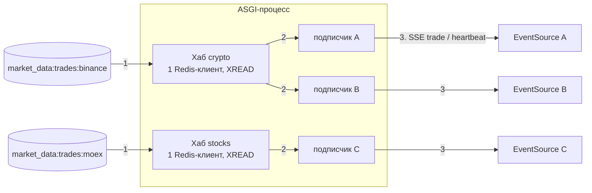
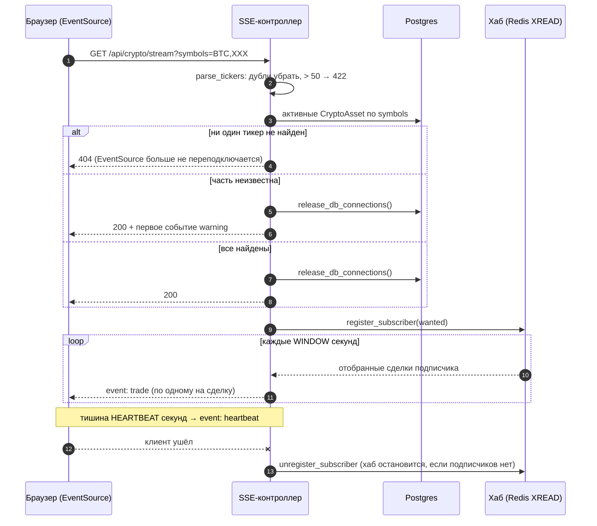
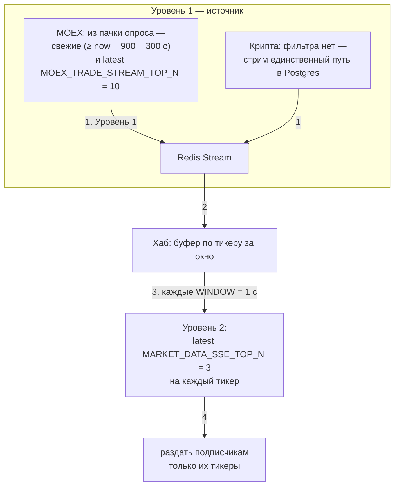

# 05. Live SSE: потоки сделок в браузер

Два эндпоинта отдают сделки в реальном времени по Server-Sent Events:

| Эндпоинт | Фильтр | Источник |
|---|---|---|
| `GET /api/crypto/stream` | `?symbols=BTC,ETH` | Redis Stream `market_data:trades:binance` ([02](02-crypto-binance.md)) |
| `GET /api/stocks/stream` | `?secids=SBER,GAZP` | Redis Stream `market_data:trades:moex` ([03](03-moex-cbr.md)) |

Без фильтра отдаются все активные активы. SSE-поток — надстройка над БД: он не гарантирует полноты (отбираются последние сделки) и не умеет догонять пропущенное.

## Общая схема



**Что за чем:**

1. Хаб читает Redis Stream (один читатель на стрим на процесс).
2. Хаб раздаёт отобранные сделки подписчикам: каждый подписчик соответствует одному SSE-соединению.
3. Подписчик отправляет сделки браузеру событиями `trade` (в тишине — `heartbeat`).

Ключевая идея: **один Redis-читатель на стрим на процесс** (хаб), а не по клиенту на соединение. Хаб запускается лениво, когда приходит первый подписчик, и останавливается, когда уходит последний. Число соединений с Redis не растёт вместе с числом SSE-клиентов.

## Жизненный цикл запроса



**Что за чем:**

1. Браузер открывает `GET /api/crypto/stream`, возможно с фильтром `?symbols=`.
2. Контроллер разбирает список тикеров: убирает дубли, больше 50 — ошибка 422.
3. Проверяет по БД, какие из тикеров существуют и активны.
4. Один из трёх исходов (на схеме три ветки `alt`, номера идут подряд):
   - ни один тикер не найден → ответ 404, `EventSource` больше не переподключается (шаг 4);
   - часть тикеров неизвестна → соединения с БД освобождаются, ответ 200 и первым событием `warning` (шаги 5–6);
   - все найдены → соединения с БД освобождаются, ответ 200 (шаги 7–8).
5. Контроллер подписывается на хаб (шаг 9).
6. Каждые `WINDOW` секунд хаб передаёт отобранные сделки (шаг 10), а контроллер отправляет их браузеру по одному событием `trade` (шаг 11). В тишине шлётся `heartbeat`.
7. Когда клиент уходит (шаг 12), контроллер отписывается; если подписчиков не осталось, хаб останавливается (шаг 13).

### Ответы и ошибки

| Ситуация | Ответ |
|---|---|
| Ни один из запрошенных тикеров не найден или не активен (или нет ни одного активного актива) | **404** `StreamAssetsNotFoundError` |
| Часть тикеров неизвестна | **200**, первым событием `warning` со списком `unknown`; поток по остальным продолжается |
| Тикеров в запросе больше `MARKET_DATA_SSE_MAX_TICKERS` (50) | **422** `TooManyTickersError` |
| Все найдены | **200** без `warning` |

Почему 404, а не «200 и закрытый поток»: на 404 `EventSource` перестаёт переподключаться, а на закрытый поток — переподключается бесконечно.

Чтобы ответ 404 мог уйти раньше статуса 200, обработчик — корутина, **возвращающая** асинхронный генератор (`async def get(...) -> AsyncIterator[...]: return ...`), а не сам генератор. Неизвестный и неактивный тикеры отвечают одинаково намеренно.

### События

Типы событий — `msgspec.Struct` с `tag_field="kind"`, иначе DMR не смог бы валидировать объединение нескольких структур.

| `event:` | `kind` | Поля |
|---|---|---|
| `trade` (крипта) | `trade` | `symbol`, `timestamp`, `price`, `volume`, `side`, `trade_id`, `data_delay_seconds` |
| `trade` (акции) | `trade` | `secid`, `timestamp`, `price`, `quantity`, `side`, `trade_id`, `period`, `data_delay_seconds` |
| `warning` | `warning` | `unknown`, `detail` |
| `heartbeat` | `heartbeat` | `timestamp` |

`price` и `volume` — строки (без потери точности `Decimal`). Для акций `data_delay_seconds` — честная метка лага бесплатной выдачи ISS (~15 минут): `timestamp` — время сделки на бирже, а не момент получения.

`SSEvent.id` **не выставляется**: докачки по `Last-Event-ID` нет. Фронтенд при каждом (пере)подключении сначала загружает состояние через REST, затем открывает поток.

## Двухуровневая выборка «latest N»

Поток сделок ликвидного тикера — сотни событий в секунду; браузеру столько не нужно. Выборка в два уровня, правило — «последние N»:



**Что за чем:**

1. Сделки попадают в Redis Stream. У MOEX они уже отобраны поллером (уровень 1: свежие, последние 10 на бумагу), у крипты идут все.
2. Хаб читает стрим и копит записи в буфере по тикерам, но только для тикеров, которые кому-то нужны.
3. Раз в секунду (окно) хаб применяет уровень 2: для каждого тикера отдельно берёт последние 3 сделки.
4. Результат раздаётся подписчикам, каждому — только его тикеры.

- **Уровень 1** есть только у MOEX (в поллере, см. [03](03-moex-cbr.md)). Для крипты фильтровать в продюсере нельзя: тот же стрим — единственный путь данных в Postgres, и отбор потерял бы данные.
- **Уровень 2** — в хабе. Каждые `MARKET_DATA_SSE_WINDOW_SECONDS` (1 с) из накопленного буфера для **каждого тикера отдельно** берутся последние `MARKET_DATA_SSE_TOP_N` (3) сделок по ключу времени. Отбор по группам нужен, чтобы ликвидный тикер не вытеснял из ленты редкие.

Верхняя оценка нагрузки на клиента:

```
событий в секунду ≤ N × число_тикеров_подписки = 3 × 50 = 150
```

Правило отбора — подменяемая функция (`services/stream_selection.py::latest`, `SelectionRule`): смена правила не требует правок хаба и контроллеров. Ключ порядка: у крипты — `timestamp`, у акций — `(timestamp, trade_id)`, чтобы сделки одной секунды упорядочивались детерминированно.

## Хаб изнутри

Хаб (`services/stream_reader/hub.py`) — по одному на `stream_key` на процесс.

1. **Старт.** Первый подписчик создаёт хаб; тот один раз превращает «конец стрима» в конкретный id через `XREVRANGE … COUNT 1`. Повторный `$` в каждом `XREAD` терял бы записи между вызовами. Подписчик, пришедший к уже работающему хабу, курсор не трогает и получает только то, что попадёт в буфер после его прихода.
2. **Чтение.** Цикл `XREAD COUNT MARKET_DATA_SSE_READ_COUNT (500) BLOCK <остаток окна>` без consumer group. Хаб читает стрим независимо от продюсера и консьюмера.
3. **Сбор.** Для каждой записи `raw_group_key` смотрит на сырые поля (`trading_pair` или `secid`) **до** декодирования. Если тикер не нужен ни одному подписчику (счётчик активных групп), запись пропускается. Дорогое декодирование (`Decimal`, `fromisoformat`) выполняется не больше одного раза на запись независимо от числа подписчиков. Битые записи логируются и пропускаются.
4. **Окно.** По истечении окна хаб применяет правило к каждой группе **один раз**, затем раздаёт результат подписчикам: каждому — только его тикеры, отсортированные по ключу порядка.
5. **Подписчик** — ячейка глубины 1 с политикой drop-oldest: непрочитанная пачка заменяется новой, а не ставится в очередь. Медленный клиент теряет старые окна, а не копит память.
6. **Остановка.** Когда уходит последний подписчик, хаб снимается с реестра, задача отменяется.

Ошибки Redis: `ConnectionError`/`TimeoutError` обрабатываются `RedisRetryLoop` (бэкофф 1→30 с), курсор `last_id` сохраняется между переподключениями. Любая другая ошибка останавливает хаб: он логирует исключение и закрывает всех подписчиков, их генераторы завершаются, поток обрывается, а `EventSource` в браузере переподключается сам.

`socket_timeout` клиента хаба = `WINDOW + 10 с`.

### Heartbeat

`BaseSSEController.streaming_ping_seconds = None`: встроенный ping DMR отключён. Его ожидающая задача переживала отключение клиента, из-за чего `aclose()` падал с `RuntimeError: asynchronous generator is already running`, а генератор с клиентом Redis жил до остановки event loop. Вместо него поток сам шлёт именованное событие `heartbeat` каждые `MARKET_DATA_SSE_HEARTBEAT_SECONDS` (15 с) тишины. Браузерный `EventSource` ловит его через `addEventListener("heartbeat", …)`.

### Соединения с БД

Django закрывает соединения на `request_finished`, то есть когда клиент уходит, а у стрима это часы. Поэтому сразу после проверки тикеров контроллер вызывает `release_db_connections()` (безусловный `connections.close_all()`, а не `close_old_connections`: в production `CONN_MAX_AGE = 60`), а из генератора событий ORM больше не вызывается. Иначе каждый долгий стрим держал бы соединение Postgres.

Внутри `sse_events` вложенный читатель обёрнут в `aclosing`: при уходе клиента DMR закрывает внешний генератор, но не вложенный, и без явного закрытия подписчик (и хаб) жили бы до сборщика мусора.

## Связь с ретеншном стрима

Хаб читает «с хвоста» и использует окно в секунды, поэтому ему нужна лишь недавняя часть стрима. Консьюмер оставляет позади границы обрезки зазор `MARKET_DATA_TRADE_TRIM_GAP_SECONDS` (300 с), и `validate_sse_settings()` требует, чтобы он был строго больше окна SSE: иначе обрезка могла бы удалить записи у читателя, который ещё внутри окна. Там же проверяется `HEARTBEAT ≥ WINDOW` и положительность всех значений.

## Параметры

| Настройка | По умолчанию | Назначение |
|---|---|---|
| `MARKET_DATA_SSE_TOP_N` | 3 | сделок на тикер за окно (уровень 2) |
| `MARKET_DATA_SSE_WINDOW_SECONDS` | 1.0 | период отбора и раздачи |
| `MARKET_DATA_SSE_READ_COUNT` | 500 | записей за один `XREAD` |
| `MARKET_DATA_SSE_HEARTBEAT_SECONDS` | 15.0 | пауза до `heartbeat`, ≥ окна |
| `MARKET_DATA_SSE_MAX_TICKERS` | 50 | максимум тикеров в запросе (иначе 422) |
| `MOEX_TRADE_STREAM_TOP_N` | 10 | уровень 1 для акций |
| `MOEX_TRADE_STREAM_FRESHNESS_SECONDS` | 300 | «свежесть» поверх лага ISS |
| `MOEX_TRADE_STREAM_RETENTION_SECONDS` | 300 | окно, которое держит стрим акций |
