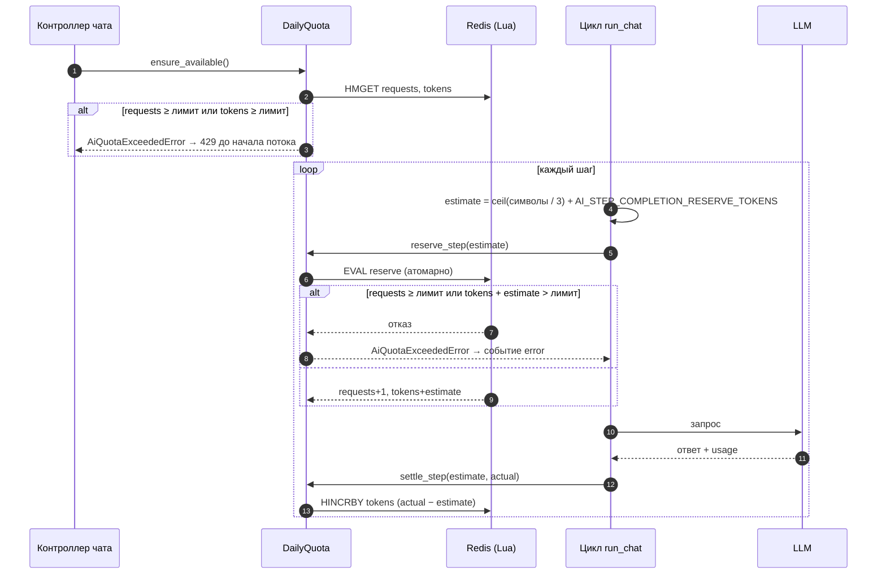

# 07. Токены и дневная квота ИИ

Дневная квота — страховка собственного расхода: она ограничивает, сколько обращений к LLM и сколько токенов проект тратит за московские сутки, независимо от провайдера (`gigachat:` и `custom:` делят один счётчик). Она не показывает остаток квоты самого провайдера.

Раздел написан по коду: `ai/services/quota/` (`counter.py`, `tokens.py`, `client.py`), `ai/services/chat/accounting.py` и `chat/loop.py`. Цикл чата — в [06-ai-chat.md](06-ai-chat.md).

## Что считается

| Счётчик | Единица | Лимит по умолчанию |
|---|---|---|
| `requests` | **один шаг цикла** = одно обращение к LLM | `AI_DAILY_REQUEST_LIMIT` = 100 |
| `tokens` | токены (вход + выход) всех шагов | `AI_DAILY_TOKEN_LIMIT` = 400 000 |

Важно: `requests` растёт на каждом **шаге**, а не на каждом вопросе пользователя. Вопрос, на котором модель трижды сходила за данными (3 шага с инструментами + финальный ответ = 4 обращения), расходует 4 из 100. Поэтому `AI_DAILY_REQUEST_LIMIT` ловит зацикливание на коротких запросах, а не дублирует лимит токенов.

Токены оцениваются тремя способами в зависимости от момента (см. ниже): оценка до шага (резерв), факт от провайдера после шага, оценка по символам, если провайдер факт не прислал.

## Где хранится

Hash на `REDIS_URL` (db 0), по ключу на московскую дату:

```
{AI_QUOTA_KEY_PREFIX}:{YYYY-MM-DD по Москве}        # пример: ai:usage:2026-10-23
```

| Поле | Смысл |
|---|---|
| `requests` | число шагов за сутки |
| `tokens` | зарезервированные и учтённые токены за сутки |
| `warned_80` | флаг: WARNING о 80% уже записан |
| `warned_exhausted` | флаг: WARNING об исчерпании уже записан |

- **Сброс — смена ключа.** Явного обнуления нет: в 00:00 МСК дата меняется и читается/пишется новый hash. Старые ключи истекают сами: `EXPIRE 172800` (48 часов) выставляется на каждом резервировании (только в Lua-скрипте резерва).
- Дата вычисляется заново **на каждом обращении** к ключу (`_key()`), а не один раз за запрос. Следствие: если полночь по Москве наступила между `reserve_step` и `settle_step` (прогон идёт до 180 с), поправка `settle` попадёт в hash уже нового дня — на `tokens` нового дня ляжет разница, возможно отрицательная. Это редкий краевой случай; в коде от него нет защиты. Если `settle_step` или установка флага первыми создадут hash нового дня, у него не будет TTL до следующего резерва.
- Клиент Redis квоты отдельный и короткоживущий (`open_quota()`): создаётся на каждый вызов, закрывается на выходе. Чат открывает его дважды — для проверки до стрима и на время самого потока.
- `resets_at` в статусе — ближайшая полночь по Москве (`next_reset`).

## Жизненный цикл шага



**Что за чем:**

1. Перед открытием потока контроллер просит квоту проверить, что лимит не исчерпан.
2. Квота читает из Redis текущие `requests` и `tokens`.
3. Если лимит уже достигнут, клиент получает 429, поток не открывается. Если нет, начинается цикл по шагам (шаги 4–13 повторяются на каждом круге).
4. Цикл чата оценивает размер запроса: `ceil(символы / 3)` плюс запас на ответ.
5. Цикл просит зарезервировать эту оценку.
6. Redis выполняет проверку и увеличение счётчиков одной атомарной операцией.
7. Если не хватает лимита, Redis отвечает отказом (шаг 7), квота поднимает ошибку (шаг 8), пользователь получает событие `error`, и шаги 9–13 не выполняются.
8. Если лимита хватает, Redis увеличивает `requests` на 1 и `tokens` на оценку и возвращает новые значения (шаг 9).
9. Цикл отправляет запрос в LLM (шаг 10) и получает ответ с фактическим расходом токенов (шаг 11).
10. Цикл просит пересчитать резерв по факту (шаг 12), Redis добавляет разницу `actual − estimate`, она может быть и отрицательной (шаг 13).

### 1. Проверка до потока — `ensure_available()`

Дешёвое чтение без резервирования, чтобы 429 ушёл обычным JSON до статуса 200:

```
пропустить, если  requests < AI_DAILY_REQUEST_LIMIT   И   tokens < AI_DAILY_TOKEN_LIMIT
иначе             → AiQuotaExceededError (429)
```

Проверка неатомарна и гонку не закрывает: её закрывает резервирование.

### 2. Резерв — `reserve_step(estimate)`

Одна атомарная Lua-операция (`EVAL`): параллельные запросы не могут пройти проверку на одном и том же остатке.

```
отказ,       если  requests ≥ AI_DAILY_REQUEST_LIMIT
             или   tokens + estimate > AI_DAILY_TOKEN_LIMIT
иначе:  requests += 1,  tokens += estimate,  EXPIRE ключа 172 800 с
```

Оценка резерва до шага (`estimate_step_reservation`):

```
chars    = Σ по всем сообщениям запроса ( len(content) + Σ по tool_calls ( len(name) + len(arguments_json) ) )
estimate = ceil(chars / 3) + AI_STEP_COMPLETION_RESERVE_TOKENS       # 3 символа ≈ 1 токен, запас на ответ 2000
```

В `chars` входят системный промпт, вся история и накопленные на предыдущих шагах вызовы и результаты инструментов. Описания и JSON Schema инструментов в оценку **не входят**, хотя в запрос уходят; поэтому настоящий вход обычно больше оценки по символам, а выравнивает разницу `settle_step`.

Отказ резерва — тот же `AiQuotaExceededError`, но он случается уже внутри потока (статус 200 отправлен), поэтому пользователь видит событие `error` с текстом «Дневной лимит обращений к ИИ исчерпан, попробуйте завтра». Так бывает, когда на момент `ensure_available` лимит ещё не достигнут, а `tokens + estimate` его уже превышает.

### 3. Факт — `settle_step(reserved, actual)`

После шага резерв заменяется фактическим расходом:

```
delta = actual − reserved
если delta ≠ 0:  tokens += delta                  # HINCRBY, delta может быть отрицательной (возврат) или положительной
```

Факт шага (`step_tokens`):

| Откуда | Формула |
|---|---|
| провайдер прислал `usage` | `prompt_tokens + completion_tokens` |
| `usage` нет | `ceil(prompt_chars / 3) + ceil(completion_chars / 3)`, где `completion_chars = len(text) + Σ(len(name) + len(arguments_json))` по вызовам; прогон помечается `tokens_estimated = true` (в логе «(оценка)») |

`settle` может **превысить** лимит: перебор фиксируется, но шаг не отменяется — отказывает только следующий резерв.

### 4. Что, если шаг не дошёл до `settle`

Если ответ оборвался исключением (ошибка провайдера, дедлайн) или клиент закрыл соединение посреди шага, `settle_step` не вызывается, и резерв **остаётся списанным**. Это сознательно: недосчёта нет, отдельный `finally` не нужен (`await` в нём при отмене генератора ненадёжен). Цена — прерванный шаг записывается по консервативной оценке `estimate`.

## Пример расчёта

Значения лимитов по умолчанию, длина системного промпта на момент написания — 4 752 символа (при смене `prompt_text.py` числа изменятся). Пользователь задаёт вопрос из 200 символов, истории нет.

**Шаг 1.**

```
chars    = 4752 + 200 = 4952
estimate = ceil(4952 / 3) + 2000 = 1651 + 2000 = 3651
```

Резерв: `requests: 0 → 1`, `tokens: 0 → 3651`. Допустим, провайдер сообщил `prompt = 3100`, `completion = 80` (иллюстративные числа):

```
actual = 3180,   delta = 3180 − 3651 = −471,   tokens: 3651 → 3180
```

Модель вызвала инструмент. К сообщениям добавились вызов и результат (допустим, ещё 1 800 символов).

**Шаг 2.**

```
chars    = 4952 + 1800 = 6752  (плюс аргументы вызова)
estimate = ceil(6752 / 3) + 2000 = 2251 + 2000 = 4251
```

Резерв: `requests: 1 → 2`, `tokens: 3180 → 7431`; после ответа — `settle` по факту. Итог вопроса: 2 обращения и сумма фактических токенов обоих шагов.

**Границы.** Максимальная оценка одного шага при предельной истории (12 000 символов) до накопления результатов инструментов:

```
estimate_max ≈ ceil((4752 + 12000) / 3) + 2000 = 5584 + 2000 = 7584
```

Значит, когда в `tokens` накоплено больше `400 000 − 7 584 = 392 416`, новый шаг с максимальной историей уже не пройдёт резерв, даже если до лимита формально остаётся несколько тысяч токенов.

**Ёмкость в сутках.** Число вопросов в день ограничено меньшим из двух:

```
вопросов ≤ min( AI_DAILY_REQUEST_LIMIT / шагов_на_вопрос,  AI_DAILY_TOKEN_LIMIT / токенов_на_вопрос )
```

По оценке проектного решения, типичный вопрос с инструментами стоит порядка 16 тыс. токенов, то есть лимит 400 000 даёт около 25 вопросов в день.

## Предупреждения в логе

Два события, каждое — **один WARNING в сутки**, дедупликация флагами в том же hash через `HSETNX` (вернул 1 → этот процесс первый и логирует):

| Событие | Условие | Флаг |
|---|---|---|
| 80% токенов | `tokens ≥ 0.8 × AI_DAILY_TOKEN_LIMIT`, проверяется после `reserve` и после `settle` | `warned_80` |
| Лимит исчерпан | любой отказ `ensure_available` или `reserve_step` («чат отказывает до 00:00 МСК») | `warned_exhausted` |

Флаги живут столько же, сколько hash, и уходят вместе с датой. Сбой Redis при выставлении флага не пробрасывается (WARNING с трейсом, предупреждение пропускается) — иначе клиент, спамящий запросами, не должен ни ронять запрос, ни заливать лог.

После каждого прогона цикл чата логирует одну INFO-строку без текста диалога: модель, число шагов, инструменты, токены `prompt+completion` (с пометкой «(оценка)», если факта не было), длительность, исход и «сегодня: N/100 запросов, Xk/400k токенов» по последним известным значениям.

## Отказ при сбое (fail closed)

Любая ошибка Redis (`RedisError`, `OSError`) в `usage`, `reserve_step` и `settle_step` превращается в `AiUnavailableError`:

| Где | Результат |
|---|---|
| `ensure_available` до потока | **503** JSON |
| `reserve_step` / `settle_step` внутри потока | событие `error` «Не удалось проверить лимит ИИ» |
| `GET /api/ai/status` | `usage: null`, без ошибки (`snapshot` глотает сбой, пишет WARNING) |

Причина: без счётчика нельзя гарантировать потолок расхода, поэтому при недоступном Redis бесплатных токенов не выдаётся.

## Состояние в `GET /api/ai/status`

```json
"usage": { "requests": 12, "requests_limit": 100, "tokens": 48210, "tokens_limit": 400000, "resets_at": "2026-10-24T00:00:00+03:00" }
```

`requests` и `tokens` читаются из hash текущей даты. Это те же значения, по которым принимаются решения о лимите, то есть включают резервы идущих сейчас шагов.

## Валидация настроек при старте

- `AI_DAILY_REQUEST_LIMIT`, `AI_DAILY_TOKEN_LIMIT`, `AI_STEP_COMPLETION_RESERVE_TOKENS` — положительные;
- `AI_STEP_COMPLETION_RESERVE_TOKENS < AI_DAILY_TOKEN_LIMIT`: иначе ни один резерв не мог бы пройти.

## Параметры

| Настройка | По умолчанию | Назначение |
|---|---|---|
| `AI_DAILY_REQUEST_LIMIT` | 100 | шагов (обращений к LLM) в сутки |
| `AI_DAILY_TOKEN_LIMIT` | 400 000 | токенов в сутки |
| `AI_STEP_COMPLETION_RESERVE_TOKENS` | 2000 | запас на ответ в оценке шага |
| `AI_QUOTA_KEY_PREFIX` | `ai:usage` | префикс ключа |
| `KEY_TTL_SECONDS` (константа) | 172 800 | срок жизни ключа |
| `WARN_FRACTION` (константа) | 0.8 | порог предупреждения |
| `CHARS_PER_TOKEN` (константа) | 3 | символов на токен в оценке |

## Почему лимит токенов именно такой

Бесплатный режим GigaChat для физических лиц — годовой пакет токенов. Значение 400 000 в сутки сознательно выше «пакет / 365»: разработка идёт неравномерно, худший исход — пакет кончится раньше года, и модель переключается через `AI_MODEL`; GigaChat при этом просто перестаёт отвечать, списаний нет. Остаток годового пакета версия API v1 не показывает, поэтому проект его не отслеживает. Обоснование и принятые риски — в `openspec/changes/add-ai-market-chat/design.md`.

## Чего в коде пока нет

Проект `design.md` изменения `add-ai-market-chat` описывает также ограничение частоты запросов по IP и слоты параллельных чатов (`services/limits/`). В текущем коде этого модуля нет: единственным ограничителем расхода является дневная квота, описанная выше. Для GigaChat это значит, что параллельные запросы одного пользователя ограничивает только сам провайдер.
